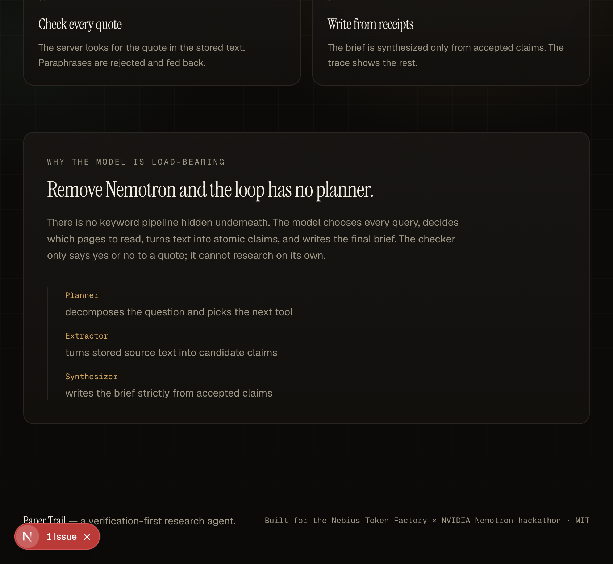
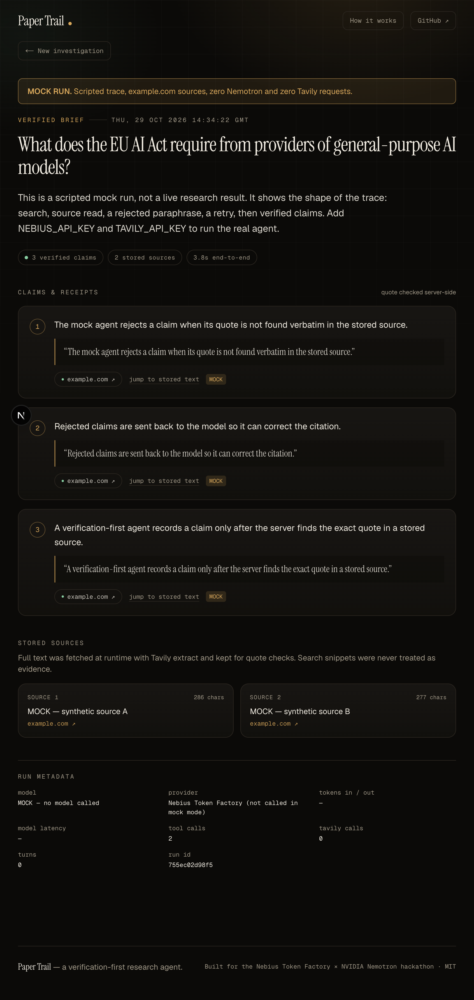

# Paper Trail

**A research agent that shows its receipts.** Paper Trail asks Nemotron to investigate a question, then refuses to render a claim unless the exact quote behind it is found in a source the agent actually read. Rejected claims stay visible in the trace, so you can watch the model get corrected instead of trusting a confident paragraph.

Every claim in the output carries a verbatim quote and a clickable source. Search snippets are never treated as evidence.

[](./LICENSE)


**Live demo:** `https://paper-trail-taupe-pi.vercel.app` — runs in labelled **MOCK** mode until API keys are attached (see [Status](#status)). 
**Demo video:** _not recorded yet — see [DEMO.md](./DEMO.md) for the 3:00 shot list._


## The 30-second version

1. Ask a question that has public, checkable evidence.
2. Nemotron calls Tavily search, then Tavily extract to store the full page.
3. It proposes a claim with a quote. The server searches the stored text for that quote.
4. A paraphrase comes back **rejected** — red step in the trace.
5. The model retries with a real sentence, the claim is accepted, and the brief is written only from accepted claims.

The product is the red step. Everything else is a normal research agent.

## How it works

```mermaid
flowchart LR
  U[User] -->|question| UI[Next.js console]
  UI -->|POST /api/research<br/>SSE| R[Route handler]
  R --> A[Agent loop<br/>max 8 turns]
  A -->|chat.completions, stream| N[Nemotron 3 Super<br/>Nebius Token Factory]
  N -->|tool_calls| A
  A -->|web_search / read_source| T[Tavily API]
  T -->|results + extracted text| A
  A -->|record_claim + quote| V{Quote verifier}
  V -->|found| C[(Stored source<br/>+ claim)]
  V -->|not found| A
  A -->|brief| UI
  C --> B[/brief/:id]
```

### The three tools

| Tool | What it touches | What it does |
| --- | --- | --- |
| `web_search` | Tavily `/search` (live web) | Finds candidate URLs. Snippets are labelled as leads, never evidence. |
| `read_source` | Tavily `/extract` + server memory/disk | Fetches the page, stores the full text, returns a `source_id` and a 2,000-character preview. |
| `record_claim` | Quote verifier + brief store | Checks the quote against the stored text character-for-character (whitespace/case normalized). Accepts, or rejects with a reason fed back to the model. |

There is no hidden keyword pipeline and no model-authored code execution. If Nemotron is removed, nothing plans the search, extracts claims, or writes the brief.

## How we used Nemotron / NVIDIA models

- **Model:** `nvidia/nemotron-3-super-120b-a12b` — one constant in [`src/lib/config.ts`](./src/lib/config.ts), overridable with `NEBIUS_MODEL`.
- **Verified against the live catalog on 2026-10-29:** 256K-token context, `us-central1`, `$0.30` per 1M input tokens, `$0.90` per 1M output tokens (`$0.06` cached input). Source: [Nebius Token Factory model catalog](https://tokenfactory.nebius.com/model-catalog.md). The catalog is the authority; re-check it before changing the string.
- **Cheap fallback:** `nvidia/NVIDIA-Nemotron-3-Nano-30B-A3B` (262K context, `$0.06`/`$0.24`) is documented in `.env.example` as an alternative, not silently swapped in.
- **What the model actually does:** decomposes the question, chooses every search query, decides which URLs to read, turns source text into atomic claims, and writes the final summary from accepted claims only. The verifier can only say yes/no to a quote — it cannot research.
- **Integration:** OpenAI-compatible `POST /v1/chat/completions` with `stream: true`, streamed tool calls, and `stream_options.include_usage`. Tool schemas use the standard OpenAI function-calling format ([Nebius docs](https://docs.tokenfactory.nebius.com/ai-models-inference/function-calling)).
- **Streaming:** tokens are forwarded to the browser over SSE as they arrive; tool calls are accumulated server-side and executed by the backend.
- **Resilience:** 429/5xx and network errors retry with exponential backoff + jitter (honouring `Retry-After`) before any bytes are read. Mid-stream failure produces a readable error, not a hang.
- **Observability:** each model call logs `event:"nemotron_call"` with model, latency, prompt/completion tokens, tool-call count, attempts, and finish reason. Each Tavily request logs `event:"tavily_call"` with endpoint, latency, and result counts.

No benchmarks or quality scores are claimed here — none were run.

## Where Nebius Token Factory helped

- **One OpenAI-compatible endpoint** (`https://api.tokenfactory.nebius.com/v1/`) meant no custom SDK: streaming, tool calling, and usage reporting worked through the standard chat-completions shape ([quickstart](https://docs.tokenfactory.nebius.com/quickstart)).
- **One key, no GPU ops.** The app is a single Next.js service; Token Factory handled inference while the demo stayed deployable on Vercel.
- **A live, machine-checkable catalog.** The model ID and price were taken from the published catalog rather than guessed, which is why the model string lives in one constant and is re-verifiable with `GET /v1/models`.
- **Failure modes are legible.** HTTP 401/404/429 map to distinct, actionable messages in the UI instead of a generic spinner.

## Tavily at runtime (exact locations)

This is a real runtime call, not build-time and not mocked (in live mode):

- **HTTP calls:** [`src/lib/tavily.ts`](./src/lib/tavily.ts) — `https://api.tavily.com/search` and `https://api.tavily.com/extract`, using `Authorization: Bearer $TAVILY_API_KEY`, 20s timeout, one retry on 429/5xx.
- **Tool wrappers:** [`src/lib/tools.ts`](./src/lib/tools.ts) — `web_search` and `read_source`.
- **Entry route:** [`src/app/api/research/route.ts`](./src/app/api/research/route.ts) → [`src/lib/agent.ts`](./src/lib/agent.ts).
- **UI proof:** source URLs are rendered as clickable links in the brief, and the trace shows each Tavily tool call with latency.

A judge can verify it in 30 seconds: open DevTools → Network → filter `tavily` → run a question. You will see `POST /search` and `POST /extract`. Server logs show the matching `event:"tavily_call"` lines.

## Proof it's real

Replace `<host>` with the deployment host. These commands print the model ID, the token/latency metadata, the claims, and their quotes.

```bash
# 1. Which model and mode is this deployment using?
curl -s https://<host>/api/health | jq

# 2. Run a real investigation; SSE streams every step
curl -N -X POST https://<host>/api/research \
  -H 'content-type: application/json' \
  -d '{"question":"What does the EU AI Act require from providers of general-purpose AI models?"}' \
  | tee /tmp/papertrail.sse

# 3. Pull the run id from the final event, then fetch the stored brief
BRIEF_ID=$(grep -o '"type":"brief".*' /tmp/papertrail.sse | grep -o '"id":"[a-z0-9]*"' | head -1 | cut -d'"' -f4)
curl -s "https://<host>/api/brief/$BRIEF_ID" \
  | jq '{meta, claims: [.claims[] | {text, quote, sourceId}]}'
```

In the SSE stream, look for:

- `"type":"start"` with `"model":"nvidia/nemotron-3-super-120b-a12b"`;
- `"type":"step"` entries for `web_search`, `read_source`, `record_claim`;
- at least one `"status":"rejected"` verdict when the model paraphrases (the demo is built around this);
- `"type":"brief"` with `meta.modelMs`, `meta.tokensIn`, `meta.tokensOut`, and `meta.tavilyCalls`.

Server log shape (local `npm run dev` or `vercel logs`):

```text
{"event":"nemotron_call","model":"nvidia/nemotron-3-super-120b-a12b","latencyMs":…,"promptTokens":…,"completionTokens":…,"toolCalls":…}
{"event":"tavily_call","endpoint":"/search","latencyMs":…,"results":…}
{"event":"tavily_call","endpoint":"/extract","latencyMs":…,"chars":…}
```

## Status

| Item | State |
| --- | --- |
| App, agent loop, verifier, UI | Built and tested (see below) |
| Deployed demo | `https://paper-trail-taupe-pi.vercel.app` — **MOCK mode**: no keys are attached to this deployment |
| Live Nemotron + Tavily proof | **Blocked on keys.** Add them, redeploy, then run the curl commands above |
| Demo video | **Blocked on recording** — shot list is in [DEMO.md](./DEMO.md) |

MOCK mode is explicit everywhere: an amber banner in the console, `MOCK` tags on sources, `"mock":true` in the brief, and `mode:"mock"` in `/api/health`. It makes **zero** network calls and never presents scripted text as a live result.

## Run it

```bash
git clone https://github.com/BMO-can-code/paper-trail.git
cd paper-trail
npm install
cp .env.example .env       # paste NEBIUS_API_KEY and TAVILY_API_KEY
npm run dev                # http://localhost:3000
```

Without keys the app still starts, in labelled mock mode.

```bash
npm run typecheck
npm run lint
npm run build
```

### Environment

| Variable | Required | Purpose |
| --- | --- | --- |
| `NEBIUS_API_KEY` | live mode | Token Factory key, server-side only |
| `TAVILY_API_KEY` | live mode | Tavily key, server-side only |
| `NEBIUS_MODEL` | no | Defaults to the verified model ID |
| `NEBIUS_BASE_URL` | no | Defaults to `https://api.tokenfactory.nebius.com/v1/` |
| `MOCK_MODE` | no | `1` forces the scripted trace even with keys |
| `PAPERTRAIL_DATA_DIR` | no | Durable brief storage; otherwise `.data/` locally and `/tmp` on Vercel |
| `TAVILY_BASE_URL` | no | Test harness only; leave unset in deployments |

Keys are read only in server modules. There is no `NEXT_PUBLIC_` secret and no client-side model call.

### Deploy

```bash
vercel --prod
vercel env add NEBIUS_API_KEY production
vercel env add TAVILY_API_KEY production
```

Vercel functions are stateless, so this deployment stores briefs under `/tmp`. Old permalinks can expire on a cold start; the UI says so. Mount a volume and set `PAPERTRAIL_DATA_DIR` for durable history.

## Safety and limits

- **Quote check:** NFKC normalization, zero-width strip, whitespace collapse, case-insensitive match. Paraphrase with changed words is rejected; the reason is returned to the model and shown as a red trace step.
- **Hard caps:** 8 model turns, 10 tool calls, 4 searches, 5 source reads, 6 claims, 55s wall clock, 45s per model call, 20s per Tavily call.
- **SSRF guard:** only `http(s)`, and loopback/private/`.local`/`.internal` hosts are refused before calling Tavily.
- **No model-authored code execution.** There is no code tool, so there is no unsandboxed execution path.
- **No rate limiting.** A public deployment should add one before sharing widely.
- **Summary scope:** the prose summary is model-written from verified claims and is not independently quote-checked sentence by sentence. The claims are the checked artifact.

## Contract test without keys

The mock path bypasses the agent, so the loop is also tested against a local OpenAI/Tavily stub:

```bash
node scripts/stub-upstream.mjs
NEBIUS_API_KEY=test TAVILY_API_KEY=test \
NEBIUS_BASE_URL=http://127.0.0.1:4010/v1 \
TAVILY_BASE_URL=http://127.0.0.1:4010 \
npm run dev
```

This exercises streaming, tool-call accumulation, the rejection/retry path, quote verification, and persistence. It does **not** test Nemotron or Tavily themselves — that is what the live curl proof is for.

## Screenshots

| Landing | Trace with a rejected claim | Verified brief |
| --- | --- | --- |
|  |  |  |

## Repo map

```text
src/app/api/research/route.ts   SSE entry point
src/lib/agent.ts                bounded tool loop
src/lib/nemotron.ts             streaming client, retry, token/latency logs
src/lib/tavily.ts               runtime Tavily search + extract
src/lib/tools.ts                tool schemas, SSRF guard, quote verifier
src/lib/store.ts                brief persistence
src/lib/mock.ts                 labelled scripted trace
src/components/                 console, trace, brief
scripts/stub-upstream.mjs       local contract-test stub (not deployed)
```

## License

MIT — see [LICENSE](./LICENSE).
